# E-Commerce Platform

A production-grade, cloud-native e-commerce platform built as a comprehensive DevOps portfolio project. This platform demonstrates modern software engineering practices including GitOps, Infrastructure as Code (IaC), CI/CD automation, container orchestration, observability, and security scanning.

**Live Demo:** https://ahmedmahfouz.click

**Tech Stack:** FastAPI (Python), React (TypeScript), PostgreSQL, MongoDB, Docker, Kubernetes (EKS), Terraform, ArgoCD

---

## Table of Contents

1. [Overview](#overview)
2. [Architecture](#architecture)
3. [Project Structure](#project-structure)
4. [Quick Start](#quick-start)
5. [Local Development](#local-development)
6. [Infrastructure & Deployment](#infrastructure--deployment)
7. [CI/CD Pipelines](#cicd-pipelines)
8. [Observability & Security](#observability--security)
9. [Screenshots](#screenshots)
10. [Milestones](#milestones)

---

## Overview

This is a full-stack e-commerce platform featuring:

- **Customer-Facing:** Product catalog browsing, user authentication with email verification, shopping cart functionality
- **Admin Dashboard:** Product management with S3 image uploads, user management, order processing
- **Cloud-Native Architecture:** Microservices deployed on AWS EKS with auto-scaling, load balancing, and zero-downtime deployments
- **Security-First:** Trivy vulnerability scanning, SonarQube code quality, IAM roles with IRSA, private S3 buckets with CloudFront CDN
- **Full Observability:** Prometheus metrics, Grafana dashboards, structured logging, distributed tracing
- **GitOps Workflow:** ArgoCD manages all deployments with automated sync and drift detection

---

## Architecture

```
┌─────────────────────────────────────────────────────────────────────────────┐
│                              User Layer                                      │
│  ┌──────────────┐  ┌──────────────┐  ┌──────────────┐  ┌──────────────┐     │
│  │   Customer   │  │    Admin     │  │   Grafana    │  │   ArgoCD     │     │
│  └──────┬───────┘  └──────┬───────┘  └──────┬───────┘  └──────┬───────┘     │
└─────────┼─────────────────┼─────────────────┼─────────────────┼───────────────┘
          │                 │                 │                 │
          ▼                 ▼                 ▼                 ▼
┌─────────────────────────────────────────────────────────────────────────────┐
│                         Kong API Gateway                                    │
│           (TLS termination, rate limiting, path-based routing)              │
└──────────────────────────────┬──────────────────────────────────────────────┘
                               │
          ┌────────────────────┼────────────────────┐
          │                    │                    │
          ▼                    ▼                    ▼
┌─────────────────┐   ┌─────────────────┐   ┌─────────────────┐
│    Frontend     │   │     Backend     │   │   Monitoring    │
│ (React + Vite)  │   │   (FastAPI)     │   │  (Prometheus/   │
│   nginx:8080    │   │  Python async   │   │    Grafana)     │
└─────────────────┘   └────────┬────────┘   └─────────────────┘
                               │
          ┌────────────────────┼────────────────────┐
          │                    │                    │
          ▼                    ▼                    ▼
┌─────────────────┐   ┌─────────────────┐   ┌─────────────────┐
│    MongoDB      │   │   PostgreSQL    │   │   AWS Services  │
│   (Products)    │   │   (Users/Orders)│   │  (S3, SES, CDN) │
│                 │   │                 │   │                 │
└─────────────────┘   └─────────────────┘   └─────────────────┘
```

### Infrastructure (AWS)

- **EKS Cluster:** Kubernetes 1.31+ with managed node groups
- **Networking:** VPC with public/private subnets, NAT Gateways, Internet Gateway
- **Ingress:** Kong Gateway with AWS Load Balancer Controller
- **DNS:** Route 53 with ExternalDNS automation
- **TLS:** cert-manager with Let's Encrypt certificates
- **Storage:** EBS volumes via CSI driver (gp3)
- **CDN:** CloudFront distribution for image assets
- **Email:** AWS SES for transactional emails

---

## Project Structure

```
ecommerce-platform/
├── backend/                    # FastAPI application (Python)
│   ├── app/
│   │   ├── config.py           # Pydantic settings management
│   │   ├── core/
│   │   │   ├── database.py     # PostgreSQL async engine
│   │   │   └── mongodb.py      # MongoDB async client
│   │   ├── modules/
│   │   │   ├── auth/           # JWT authentication & email verification
│   │   │   └── products/       # Product catalog (MongoDB)
│   │   ├── routers/
│   │   └── services/           # SES email & S3 helpers
│   ├── alembic/                # Database migrations
│   ├── scripts/                # CLI management tools
│   ├── tests/                  # Pytest test suite
│   ├── Dockerfile              # Multi-stage production build
│   └── docker-compose.yml      # Local development
├── frontend/                   # React SPA (TypeScript + Vite)
│   ├── src/
│   │   ├── api/                # REST API client modules
│   │   ├── auth/               # JWT context & protected routes
│   │   ├── components/         # Reusable UI components
│   │   └── pages/              # Route-level pages
│   ├── Dockerfile              # nginx-served production build
│   └── nginx.conf              # Reverse proxy config
├── helm/                       # Helm charts for all services
│   ├── backend/                # FastAPI deployment chart
│   ├── frontend/               # React/nginx deployment chart
│   ├── postgresql/             # PostgreSQL StatefulSet chart
│   └── mongodb/                # MongoDB StatefulSet chart
├── terraform/                  # Infrastructure as Code (AWS)
│   ├── modules/
│   │   ├── vpc/                # Network infrastructure
│   │   ├── eks/                # Kubernetes cluster
│   │   ├── iam/                # IRSA roles & access entries
│   │   ├── ebs/                # EBS CSI driver
│   │   ├── eks-addons/         # Helm operators (Kong, ExternalDNS, etc.)
│   │   ├── argocd/             # GitOps deployment
│   │   ├── s3-assets/          # Private S3 bucket
│   │   ├── cloudfront/         # CDN distribution
│   │   └── ses/                # Email service
│   └── environments/prod/      # Production environment config
├── gitops/                     # ArgoCD Application definitions
├── .github/workflows/          # CI/CD pipelines
│   ├── release-backend.yml     # Backend release automation
│   ├── release-frontend.yml    # Frontend release automation
│   ├── terraform.yml           # Infrastructure deployment
│   ├── terraform-destroy.yml   # Infrastructure teardown
│   └── helm-test.yml           # Helm chart validation
└── screenshots/                # Architecture documentation images
```

---

## Quick Start

### Prerequisites

- Docker and Docker Compose v2+
- Git
- kubectl and Helm (for Kubernetes deployment)
- Terraform 1.5+ (for infrastructure provisioning)

### Local Development

```bash
# 1. Clone the repository
git clone <repo-url>
cd ecommerce-platform

# 2. Create environment configuration
cp env.example .env
# Edit .env with your credentials

# 3. Start all services
docker compose up --build
```

The application will be available at:
- **Frontend:** http://localhost:5173
- **Backend API:** http://localhost:8000
- **API Docs (Swagger):** http://localhost:8000/docs

### Verify Setup

```bash
# Health check (includes PostgreSQL & MongoDB connectivity)
curl http://localhost:8000/api/v1/health

# Expected response:
# {"status":"ok","postgres":"connected","mongodb":"connected","s3":"connected"}
```

---

## Local Development

### With Docker Compose

```bash
docker compose up --build
```

This starts:
- PostgreSQL (port 5432)
- MongoDB (port 27017)
- Backend API (port 8000)
- Frontend dev server (port 5173)

### Backend Only (Python)

```bash
cd backend
python -m venv .venv
source .venv/bin/activate
pip install -r requirements.txt
uvicorn app.main:app --reload --host 0.0.0.0 --port 8000
```

### Frontend Only (Node)

```bash
cd frontend
npm install
npm run dev
```

### Database Migrations

```bash
cd backend

# Create a new migration (after model changes)
alembic revision --autogenerate -m "description"

# Apply migrations
alembic upgrade head

# Seed products
python -m scripts.seed_products /path/to/products.json

# Create admin user
python scripts/create_admin.py admin StrongPassword123!
```

### Stopping

```bash
# Stop services
docker compose down

# Stop and remove volumes (clears database data)
docker compose down -v
```

---

## Infrastructure & Deployment

### Terraform Infrastructure

The platform infrastructure is fully defined in Terraform:

| Module | Purpose | Key Resources |
|--------|---------|---------------|
| `vpc` | Networking | VPC, subnets, IGW, NAT gateways |
| `eks` | Kubernetes | EKS cluster 1.31+, managed node groups |
| `iam` | Identity | IRSA roles, EKS access entries |
| `ebs` | Storage | EBS CSI driver IAM role |
| `eks-addons` | Operators | Kong, ExternalDNS, cert-manager, AWS LBC |
| `argocd` | GitOps | ArgoCD deployment, app definitions |
| `s3-assets` | Assets | Private S3 bucket with CORS |
| `cloudfront` | CDN | CloudFront distribution with OAC |
| `ses` | Email | SES identity, DKIM, sending policies |

#### Deploy Infrastructure

```bash
cd terraform/environments/prod

# Copy and edit variables
cp terraform.tfvars.example terraform.tfvars

# Initialize and apply
terraform init
terraform plan
terraform apply
```

### GitOps with ArgoCD

All applications are managed through ArgoCD using an "App of Apps" pattern:

| Application | Wave | Purpose |
|-------------|------|---------|
| PostgreSQL | 0 | Primary database (Bitnami) |
| MongoDB | 0 | Document store (Bitnami) |
| Backend Migration | 1 | Alembic database migrations |
| Backend | 2 | FastAPI API service |
| Frontend | 3 | React SPA |
| SonarQube | 1 | Code quality analysis |
| Trivy Operator | - | Continuous security scanning |
| Kube-Prometheus-Stack | - | Monitoring & alerting |

#### Access ArgoCD

```bash
kubectl port-forward svc/argocd-server -n argocd 8080:443
# Login with credentials from terraform output
```

---

## CI/CD Pipelines

Automated CI/CD workflows using GitHub Actions:

| Workflow | Trigger | Purpose |
|----------|---------|---------|
| `release-backend.yml` | Push to `main` on `backend/**` changes | Build, test, scan, push Docker image, update Helm values |
| `release-frontend.yml` | Push to `main` on `frontend/**` changes | Build, test, scan, push Docker image, update Helm values |
| `terraform.yml` | Manual / PR | Plan and apply infrastructure changes with staged deployment |
| `terraform-destroy.yml` | Manual | Safely destroy infrastructure with confirmation |
| `helm-test.yml` | Manual / PR | Lint, validate, and smoke-test Helm charts on Kind |

### Release Process

1. Developer opens PR with Conventional Commit formatted message
2. PR-title check enforces commit format
3. Release Please generates release PR with changelog
4. Merging release PR triggers:
   - Docker build and push with semantic tags
   - Trivy vulnerability scan (CRITICAL, HIGH)
   - Automated Helm values update (GitOps)

### Image Tagging Strategy

- `{{sha}}` — Git commit SHA (every build)
- `{{version}}` — Semantic version (releases)
- `{{major}}.{{minor}}` — Major.minor version
- `{{major}}` — Major version only

---

## Observability & Security

### Monitoring Stack

**Kube-Prometheus-Stack** provides:
- **Prometheus:** Metrics collection with 15-day retention
- **Grafana:** Dashboards for Kubernetes resources, application metrics
- **Alertmanager:** Alert routing and notification

#### Access

- Grafana: https://grafana.ahmedmahfouz.click
- Credentials: `admin` / `admin`

### Security Scanning

| Tool | Purpose | Integration |
|------|---------|-------------|
| **Trivy** | Container & filesystem vulnerability scanning | GitHub Actions, Trivy Operator |
| **SonarQube** | Static code analysis, code quality gates | PR analysis, quality gates |
| **GitHub Code Scanning** | Dependency vulnerability alerts | Dependabot, security tab |

### Security Features

- **IRSA (IAM Roles for Service Accounts):** No long-term AWS credentials
- **Private S3 + CloudFront OAC:** Secure asset delivery without public buckets
- **Network Policies:** Restricted pod-to-pod communication
- **Pod Security Standards:** Non-root containers, read-only filesystems
- **mTLS:** Certificate management with cert-manager
- **Secrets Management:** Kubernetes External Secrets with AWS Secrets Manager

---

## Screenshots

Visual proof of the complete DevOps pipeline from infrastructure to application:

### 1. Continuous Delivery & GitOps

**ArgoCD Applications Dashboard**
All microservices, databases, and monitoring tools synced via GitOps:

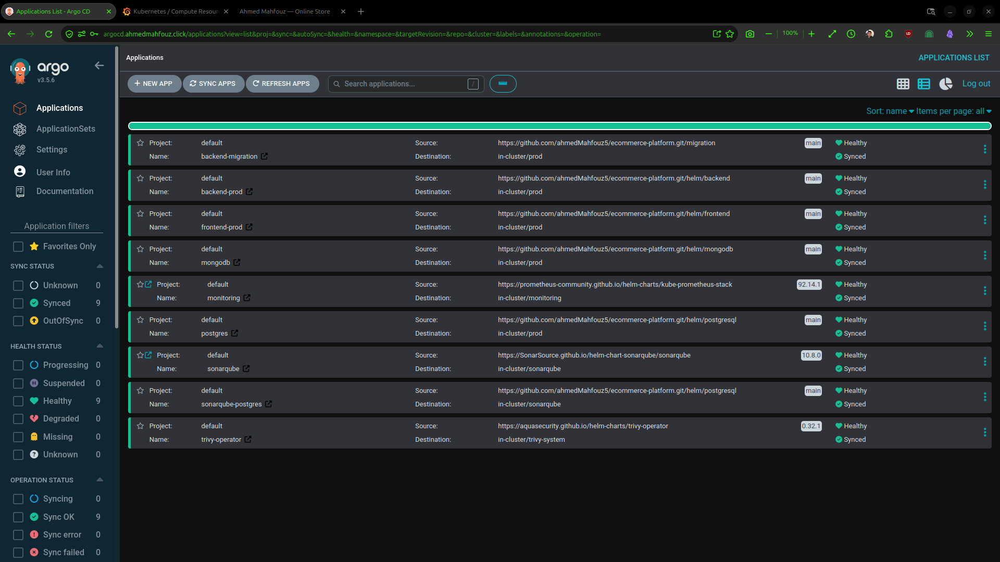

---

### 2. Infrastructure & Cloud Setup (AWS)

**AWS EKS Cluster Overview**
Kubernetes 1.31 cluster with OIDC provider and IAM role mappings:

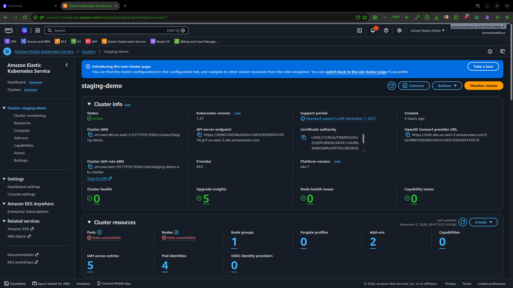

**AWS EKS Add-ons**
Managed add-ons including EBS CSI Driver with IRSA:

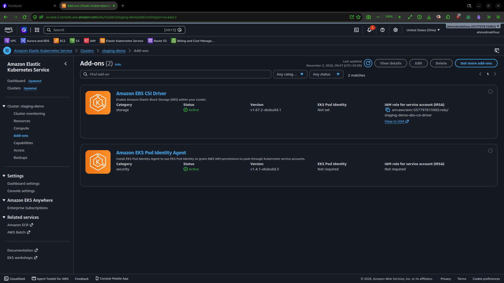

**AWS CloudFront CDN Distribution**
Custom domain `cdn.ahmedmahfouz.click` with ACM SSL certificate:

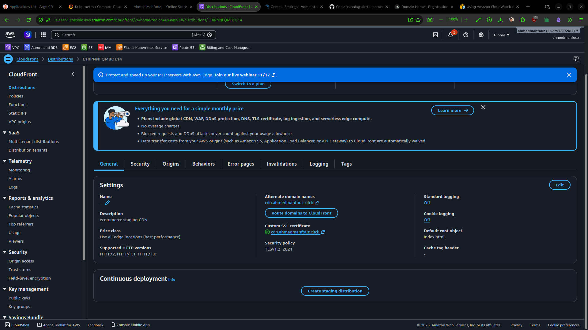

---

### 3. Domain & DNS Management

**AWS Route 53 DNS Hosted Zone**
DNS records mapping `api`, `argocd`, `grafana`, `sonarqube`, `cdn` to services:

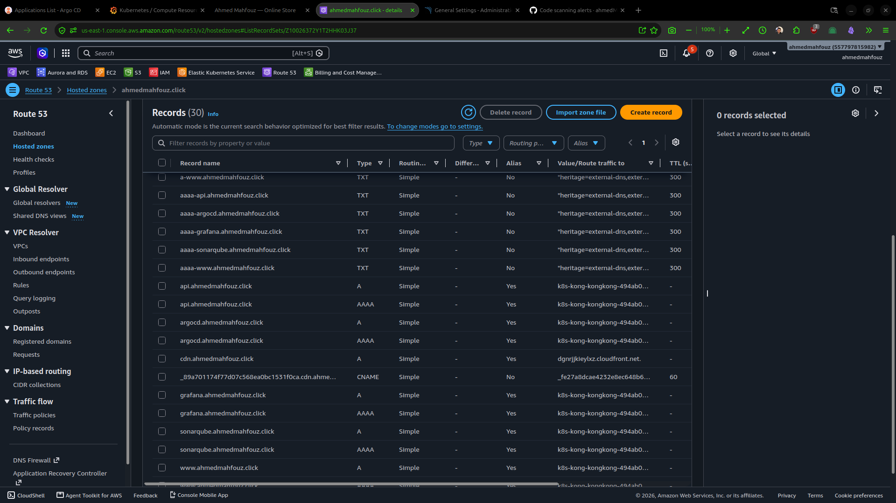

**Registrar Nameserver Configuration**
Domain pointed to AWS Route 53 authoritative name servers:

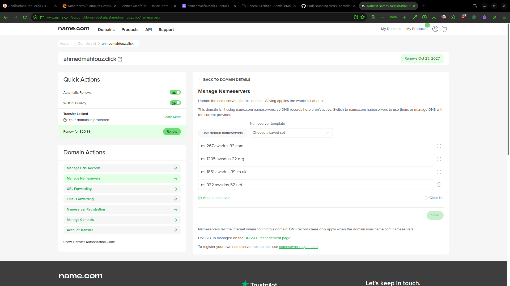

---

### 4. Observability & Monitoring

**Grafana — Kubernetes Compute Resources**
Real-time CPU, memory, and namespace quota monitoring:

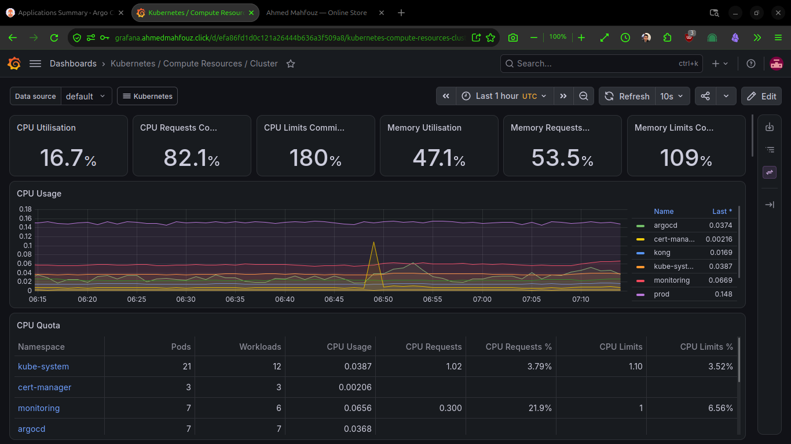

**Grafana — Trivy Operator Security Dashboard**
Cluster vulnerability, misconfiguration, and secret exposure metrics:

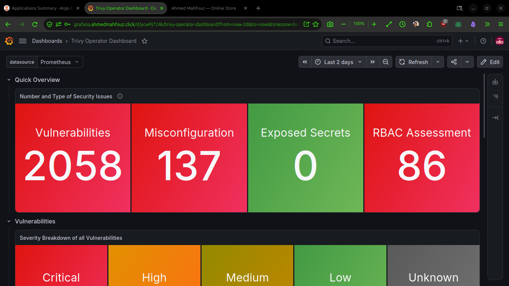

---

### 5. Code Quality & Security Scanning

**GitHub Code Scanning**
Automated Trivy vulnerability alerts by severity:

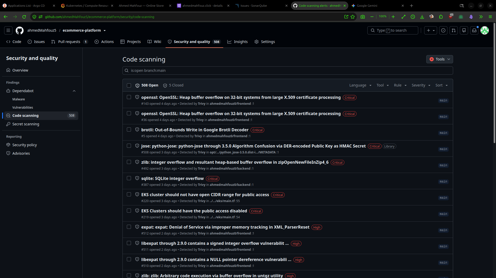

**SonarQube DevOps Platform Integration**
GitHub PR analysis and quality gate configuration:

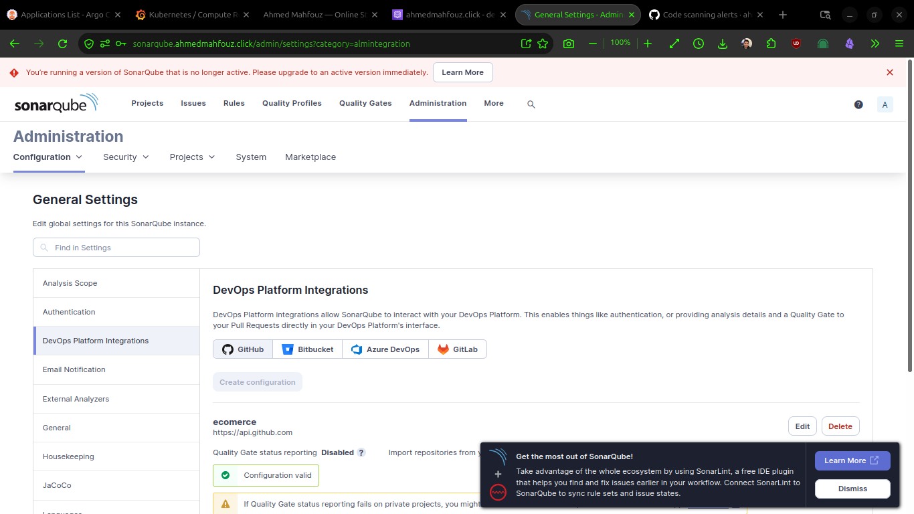

---

### 6. Application & CDN Demonstration

**E-Commerce Storefront**
Live product catalog with categories, pricing, and cart:

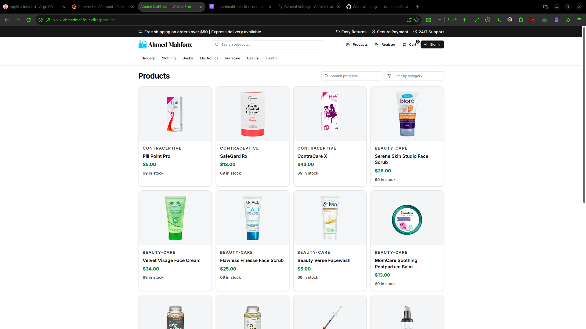

**CDN-Delivered Product Images**
Secure HTTPS asset delivery via CloudFront:

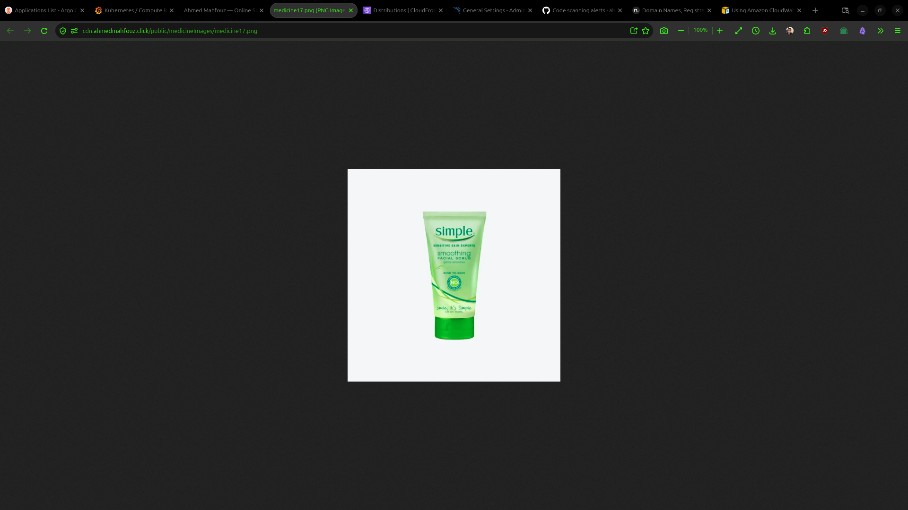

**User Registration Workflow**
Account creation with email verification:

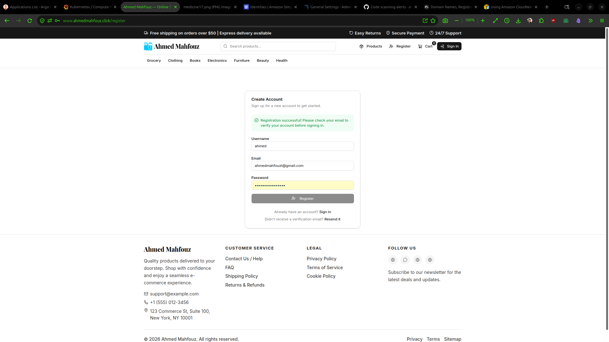

**Transactional Email (AWS SES)**
Verification email with secure call-to-action:

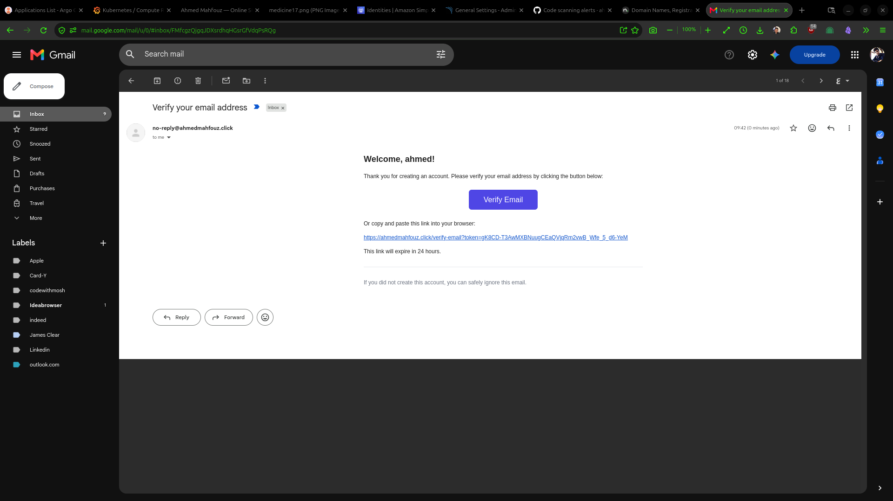

---

## Milestones

| Milestone | Description | Status |
|-----------|-------------|--------|
| 0 | Project Scaffolding — Docker, Compose, basic FastAPI + React | Complete |
| 1 | Product Catalog — PostgreSQL, MongoDB, admin CRUD, S3 image uploads | Complete |
| 2 | User Authentication — JWT, email verification, password reset, SES | Complete |
| 3 | Shopping Cart — Cart persistence, checkout flow | Pending |
| 4 | Order Management — Order lifecycle, payment integration | Pending |
| 5 | Productionization — K8s, Terraform, ArgoCD, Monitoring, Security | Complete |

---

## Commit Convention

This project uses [Conventional Commits](https://www.conventionalcommits.org/) and [semantic versioning](https://semver.org/) driven by [Release Please](https://github.com/googleapis/release-please).

Every pull request title must follow this format:

```
type: short description
```

**Allowed types:** `feat`, `fix`, `docs`, `style`, `refactor`, `perf`, `test`, `build`, `ci`, `chore`, `revert`

**Examples:**

```
feat: add product search endpoint
fix: handle empty product list returning 500
docs: explain commit convention in README
chore: upgrade postgres image to 16.4
```

**Breaking changes:**

```
feat!: drop support for Python 3.11
```

---

## Documentation

Detailed documentation is available in each component's README:

- [Backend Documentation](backend/README.md) — API routes, database models, scripts
- [Frontend Documentation](frontend/README.md) — Components, routing, styling
- [Helm Charts](helm/README.md) — Chart structure, security features, operations
- [Terraform](terraform/README.md) — Module reference, deployment commands
- [GitOps](gitops/README.md) — ArgoCD configuration, component details
- [.github/workflows](.github/workflows/README.md) — CI/CD workflow details
- [Screenshots](screenshots/project_screenshots_documentation.md) — Architecture visualization

---

## License

This project is maintained as part of a DevOps portfolio demonstration.

---

<div align="center">
  <sub>Built with FastAPI, React, Kubernetes, and AWS</sub>
</div>
