# Architecture & DevOps Screenshots Documentation

This directory contains visual proof of setup, deployment, monitoring, security, and application functionality for the **Ecommerce Platform** project.

---

## Table of Contents

- [1. Continuous Delivery & GitOps](#1-continuous-delivery--gitops)
- [2. Infrastructure & Cloud Setup (AWS)](#2-infrastructure--cloud-setup-aws)
- [3. Domain & DNS Management](#3-domain--dns-management)
- [4. Observability & Monitoring](#4-observability--monitoring)
- [5. Code Quality & Security Scanning](#5-code-quality--security-scanning)
- [6. Application & CDN Demonstration](#6-application--cdn-demonstration)

---

## 1. Continuous Delivery & GitOps

### ArgoCD Applications Dashboard
- **File Location:** `./argocd-applications-dashboard-sync-status.jpg`
- **Description:** Displays the ArgoCD UI showing all deployed microservices, database clusters, monitoring stacks, and operators (`backend-prod`, `frontend-prod`, `mongodb`, `postgres`, `sonarqube`, `trivy-operator`) running in a `Healthy` and `Synced` state.

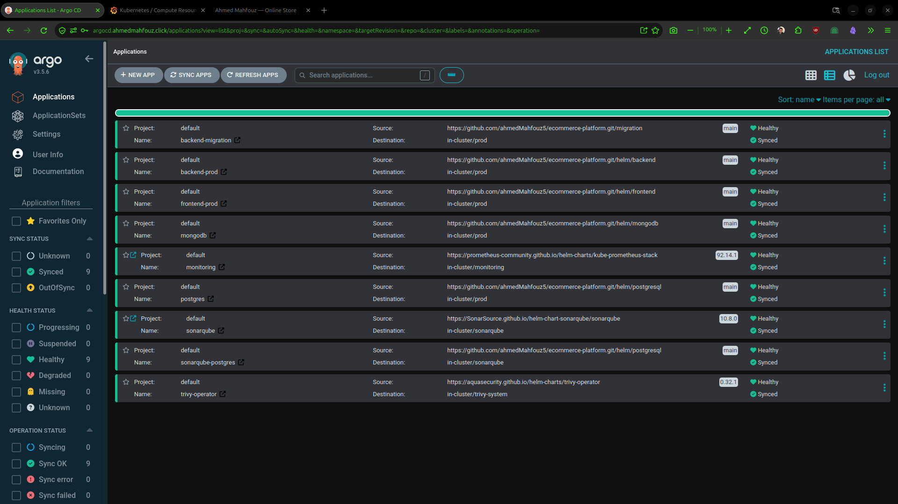

---

## 2. Infrastructure & Cloud Setup (AWS)

### AWS EKS Cluster Overview (`staging-demo`)
- **File Location:** `./aws-eks-cluster-staging-demo-overview.jpg`
- **Description:** Overview of the Amazon EKS cluster (`staging-demo`), displaying Kubernetes version `1.31`, cluster API server endpoint, OpenID Connect (OIDC) provider URL, IAM role mappings, and node group status.

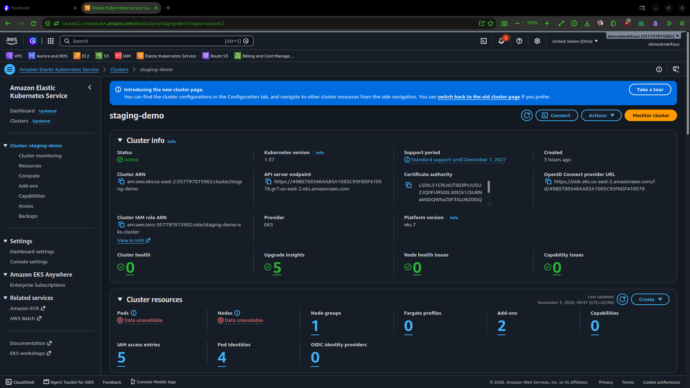

### AWS EKS Add-ons Management
- **File Location:** `./aws-eks-cluster-add-ons-management.png`
- **Description:** Configuration view of active AWS EKS add-ons within the cluster, highlighting the `Amazon EBS CSI Driver` (with IRSA configured) and the `Amazon EKS Pod Identity Agent`.

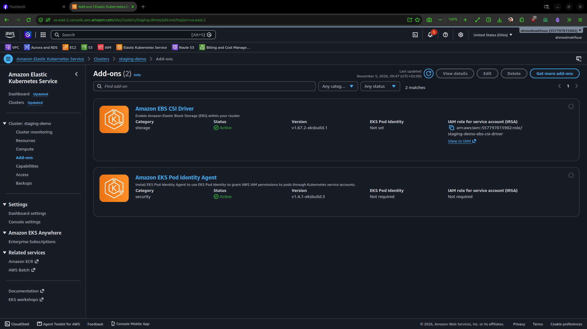

### AWS CloudFront CDN Distribution
- **File Location:** `./aws-cloudfront-distribution-settings.jpg`
- **Description:** AWS CloudFront distribution settings page showing alternate domain names (`cdn.ahmedmahfouz.click`), custom SSL certificate binding via AWS Certificate Manager (ACM), and origin routing configurations.

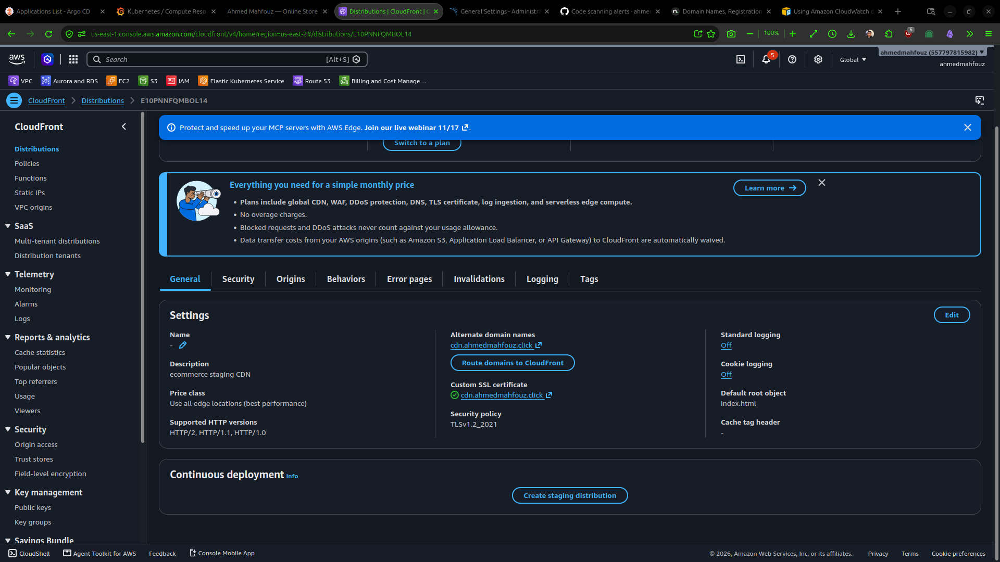

---

## 3. Domain & DNS Management

### AWS Route 53 DNS Hosted Zone
- **File Location:** `./aws-route53-hosted-zone-dns-records.jpg`
- **Description:** AWS Route 53 DNS record sets mapping domain endpoints (such as `api`, `argocd`, `grafana`, `sonarqube`, and `cdn`) to Kubernetes ingress controllers and CloudFront distributions via `A`, `AAAA`, and `CNAME` records.

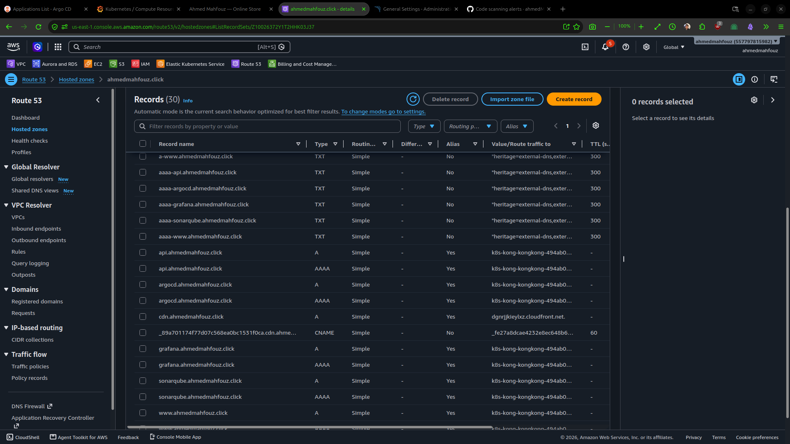

### Registrar Nameserver Configuration (Name.com)
- **File Location:** `./dns-nameservers-management-namecheap.png`
- **Description:** Domain registrar DNS management interface pointing domain name servers (`ns-*.awsdns-*.com`) to AWS Route 53 hosted zone authority servers.

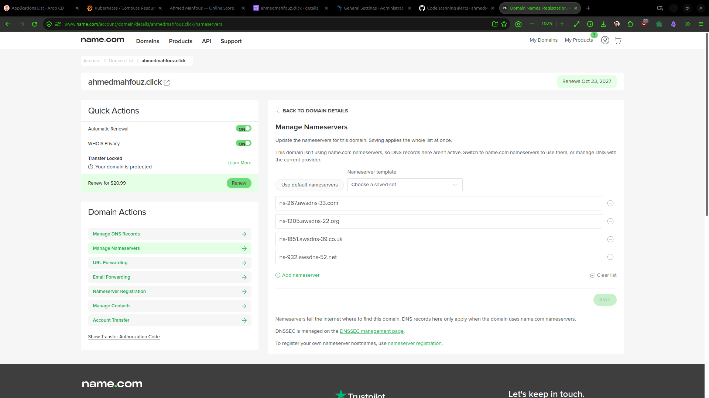

---

## 4. Observability & Monitoring

### Grafana — Kubernetes Compute Resources Dashboard
- **File Location:** `./grafana-kubernetes-compute-resources-cluster.jpg`
- **Description:** Real-time Grafana dashboard tracking cluster-wide CPU utilisation, CPU limit commitments, memory usage, and namespace resource quotas (`kube-system`, `cert-manager`, `monitoring`, `argocd`).

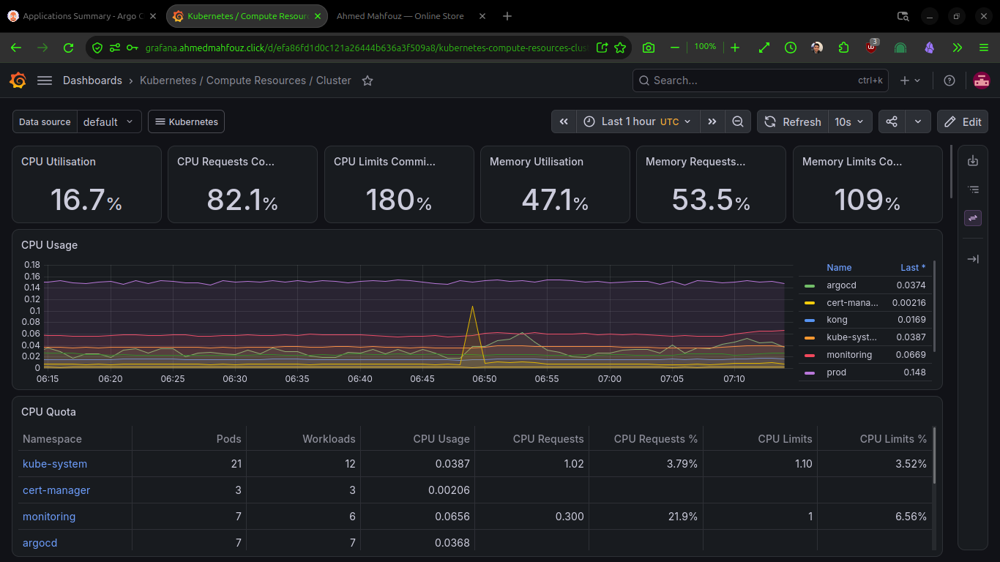

### Grafana — Trivy Operator Security Dashboard
- **File Location:** `./grafana-trivy-operator-security-dashboard.jpg`
- **Description:** Security metrics dashboard powered by Trivy Operator in Grafana, giving visibility into total cluster vulnerabilities, misconfigurations, exposed secrets, and RBAC assessments.

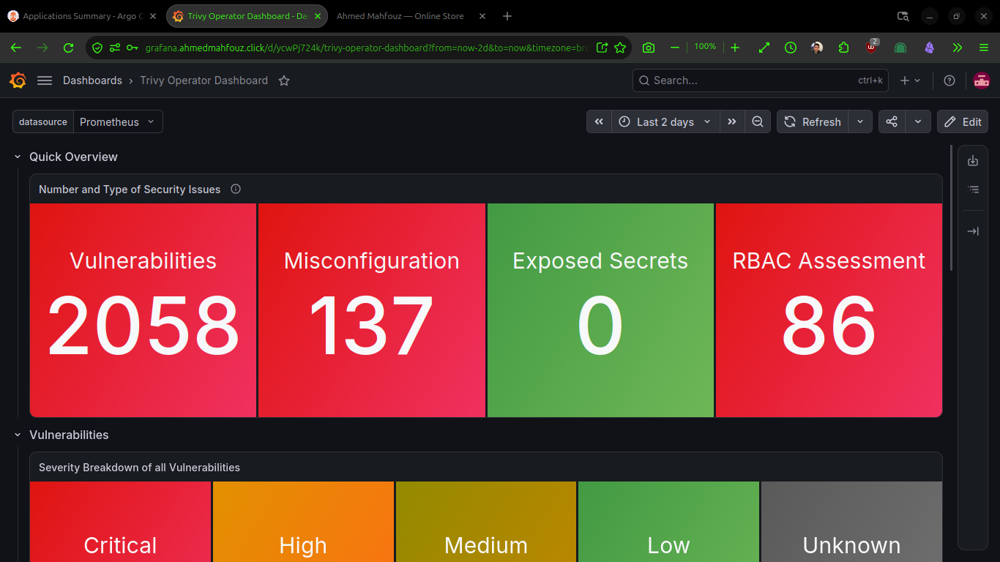

---

## 5. Code Quality & Security Scanning

### GitHub Code Scanning & Vulnerability Management
- **File Location:** `./github-code-scanning-security-vulnerabilities.jpg`
- **Description:** GitHub Security tab listing automated Code Scanning alerts generated by Trivy and static code analysis pipelines, identifying open security vulnerabilities categorized by severity.

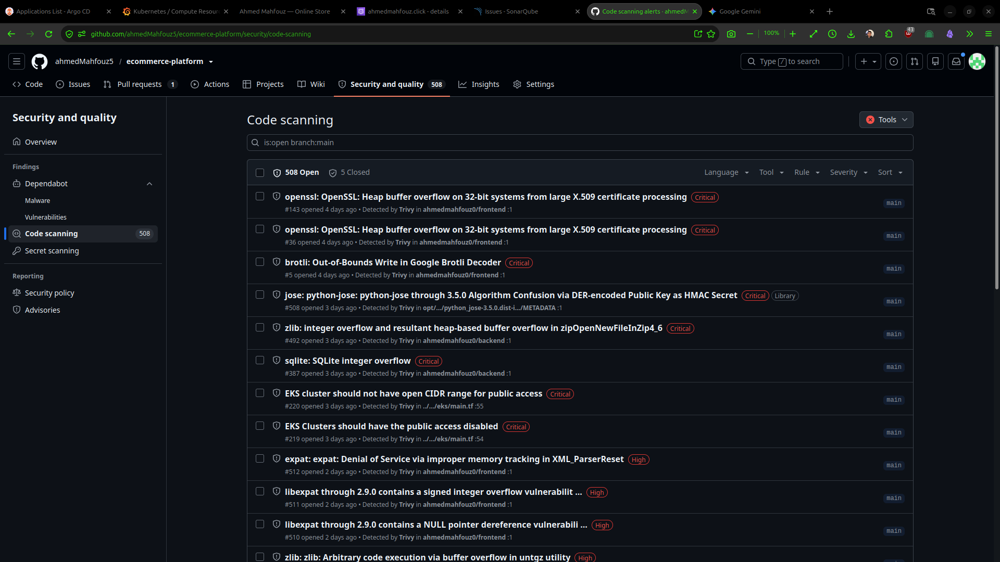

### SonarQube — DevOps Platform Integrations
- **File Location:** `./sonarqube-devops-platform-integrations.png`
- **Description:** SonarQube administration panel displaying integration settings for GitHub PR analysis and Quality Gate status reporting for the project repository.

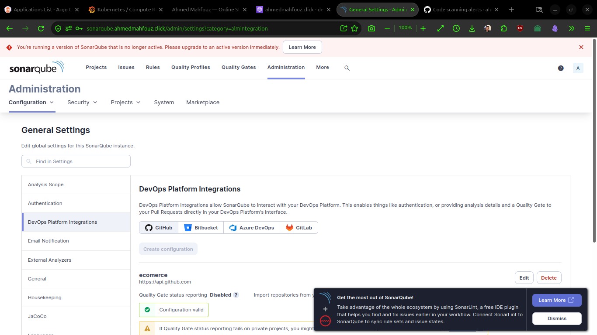

---

## 6. Application & CDN Demonstration

### E-Commerce Storefront Product Catalog
- **File Location:** `./ecommerce-product-catalog-storefront.jpg`
- **Description:** The live e-commerce application storefront rendered in the browser, showing product listings, categories, pricing, and active shopping cart controls.

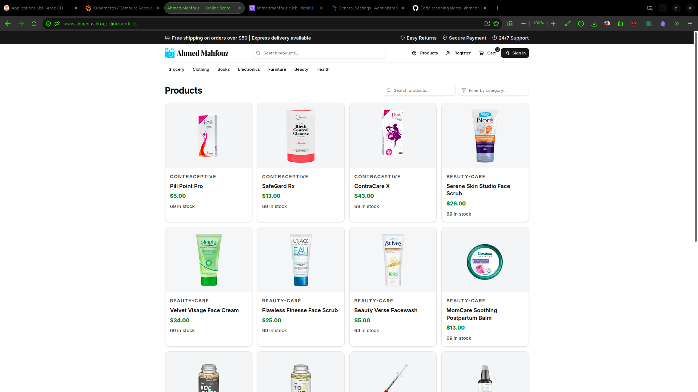

### CDN Hosted Product Asset Preview
- **File Location:** `./cdn-hosted-product-image-preview.png`
- **Description:** Direct browser verification of an asset delivered securely over HTTPS via the dedicated custom CloudFront CDN domain (`cdn.ahmedmahfouz.click`).

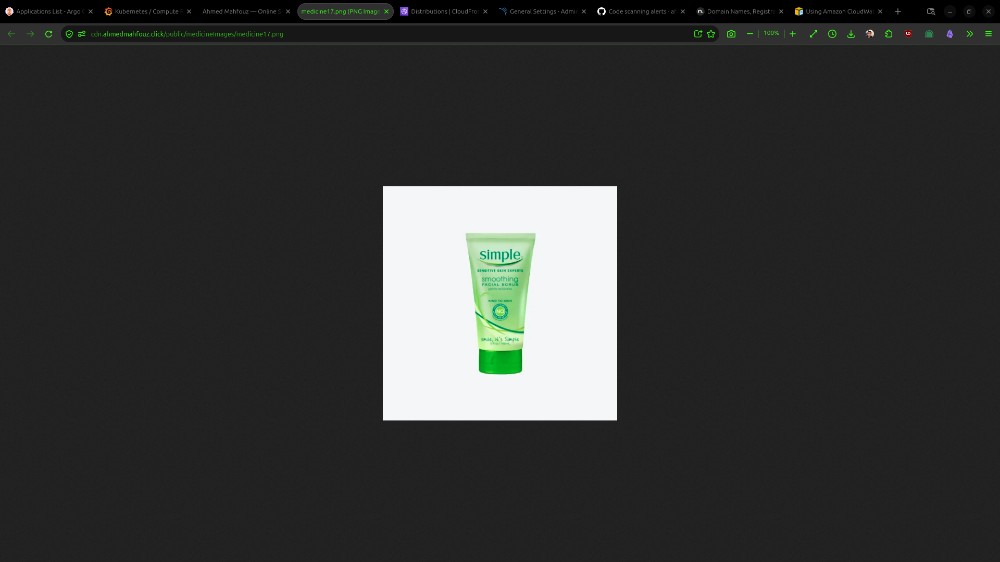

### User Registration Workflow
- **File Location:** `./ecommerce-app-registration-success.png`
- **Description:** Application account creation interface showing a successful user registration alert instructing the user to verify their email address.

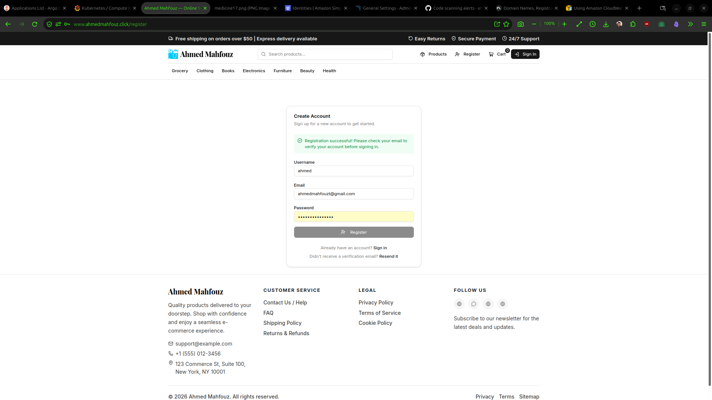

### Transactional Email Verification Inbox
- **File Location:** `./user-email-verification-inbox.png`
- **Description:** Gmail inbox receipt of automated transactional verification email sent via AWS SES (or SMTP provider), containing the verification link and secure call-to-action button.

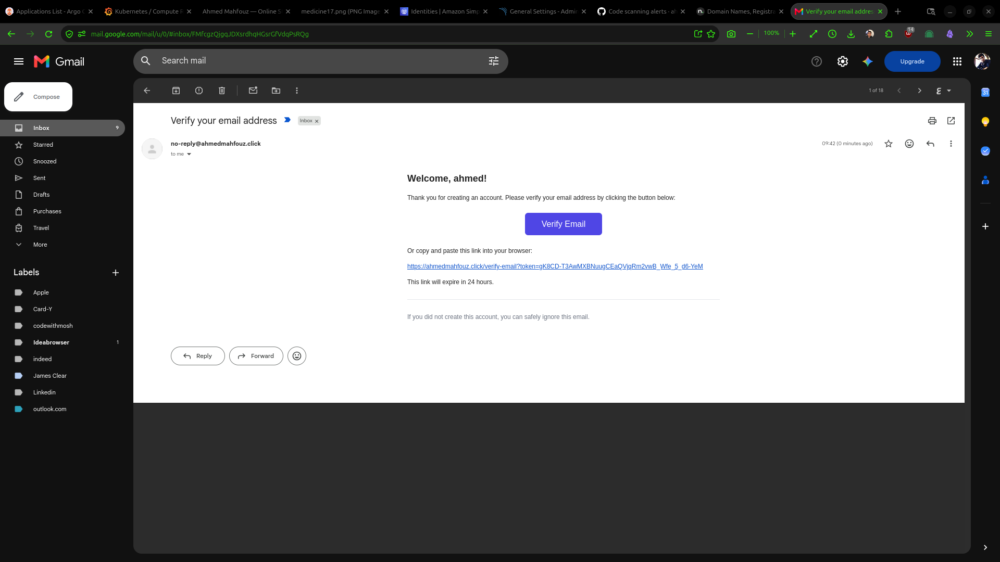